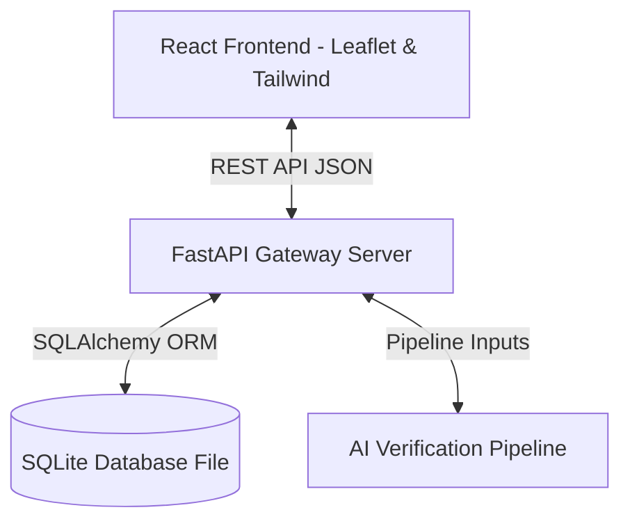

# SetuX System Architecture

## 1. System Topology Overview

SetuX is designed to decouple progress capture and progress validation. The system uses a clean client-server architecture:

## 2. Core Modules

1. **Frontend (Vite + React)**: Renders a desktop-first command center for inspecting officers and a mobile-optimized wizard for field verification reporting.
2. **Backend (FastAPI)**: Serving endpoints for project lookup, evidence uploads, verification logs, and summary analytics.
3. **Data Model (SQLAlchemy)**: Houses a simple schema mapping projects, evidence, verification audits, and officer remarks.
4. **Verification Core**: Sequentially fires:
   - **GPS Verification**: Proximity check using Haversine calculation.
   - **Progress Estimation**: CV-simulated visible completion calculations.
   - **Anomaly Score**: Aggregated safety hazard index.
